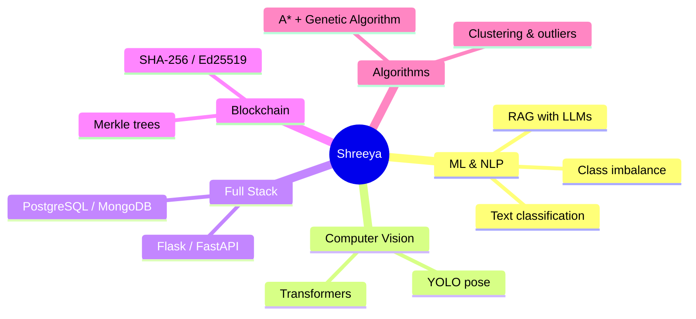

<p align="center">
  
</p>

<p align="center">
  <a href="https://www.linkedin.com/in/shreeya-s-tapaswi"></a>
  
  
  
</p>

> [!NOTE]
> **Open to internships** in software development, machine learning and blockchain. The best way to reach me is on [LinkedIn](https://www.linkedin.com/in/shreeya-s-tapaswi).

```bash
shreeya@pict:~$ whoami
student developer · ML · blockchain · dual degree (PICT + IIT Madras)

shreeya@pict:~$ cat now.txt
→ building ResumeLens AI, an explainable ATS résumé parser
→ studying AI, data warehousing & mining, smart-systems analytics
→ leading PASC-W as Vice Chairperson

shreeya@pict:~$ ./open_to --internships
```

<p align="center"></p>

<h2 align="center">🧠 What I Build</h2>



<p align="center"></p>

<h2 align="center">🛠️ Tech Stack</h2>

<p align="center">
  
</p>

<p align="center">
  
  
  
  
  
  
  
  
  
</p>

<p align="center"></p>

<h2 align="center">🚀 Featured Projects</h2>

<table>
  <tr>
    <td width="50%" valign="top">
      <h3>⛓️ <a href="https://github.com/ShreeyaTapaswi/Blockchain-Academic-Certificate-Verification">Blockchain Certificate Verification</a></h3>
      Tamper-proof academic certificate verification using hashing, digital signatures and a Merkle tree.<br><br>
      <code>Flask</code> <code>SHA-256</code> <code>Ed25519</code>
    </td>
    <td width="50%" valign="top">
      <h3>🧾 <a href="https://github.com/ShreeyaTapaswi/ResumeLens-AI">ResumeLens AI</a></h3>
      Résumé parser and ATS analyzer with structured extraction, an explainable ATS score and job-description matching.<br><br>
      <code>Flask</code> <code>spaCy</code>
    </td>
  </tr>
  <tr>
    <td width="50%" valign="top">
      <h3>💬 <a href="https://github.com/ShreeyaTapaswi/Comment-Category-Prediction">Comment Category Prediction</a></h3>
      4-class toxicity classifier on 198K comments: <b>90.7% accuracy, 82% macro F1</b>. Deployed as a Chrome extension.<br><br>
      <code>scikit-learn</code> <code>Manifest V3</code>
    </td>
    <td width="50%" valign="top">
      <h3>🕵️ <a href="https://github.com/ShreeyaTapaswi/NeuralLedger">NeuralLedger</a></h3>
      RAG system that drafts Suspicious Activity Report narratives from financial case data.<br><br>
      <code>Bedrock</code> <code>OpenSearch</code> <code>FastAPI</code>
    </td>
  </tr>
  <tr>
    <td width="50%" valign="top">
      <h3>🧍 <a href="https://github.com/ShreeyaTapaswi/Fall-Detection-For-Elderly">Fall Detection for Elderly Safety</a></h3>
      Real-time pose-based fall detection (team of 4). Co-created the annotated video dataset.<br><br>
      <code>YOLOv11</code> <code>Transformer</code> <code>FastAPI</code>
    </td>
    <td width="50%" valign="top">
      <h3>🎓 <a href="https://github.com/ShreeyaTapaswi/PASC-CCA-Platform">PASC CCA Platform</a></h3>
      Campus platform for 1,000+ students: event registration, attendance, waitlists and role-based login.<br><br>
      <code>PostgreSQL</code> <code>Full Stack</code>
    </td>
  </tr>
</table>

<details>
<summary><b>📂 More projects</b> (click to expand)</summary>
<br>

| Project | What it does |
|---|---|
| 🚁 [Drone Delivery Optimisation](https://github.com/ShreeyaTapaswi/Drone-Delivery-Optimisation) | A* pathfinding + genetic algorithm assigning packages to drones across warehouses, with an animated simulation |
| 📊 [Customer Segmentation](https://github.com/ShreeyaTapaswi/Customer-Segmentation-Clustering) | K-Means, K-Medoids (from scratch), hierarchical, DBSCAN and OPTICS, plus seven outlier detectors combined by voting |
| 🎖️ [Military Logistics Prediction](https://github.com/ShreeyaTapaswi/Military-Logistics-Optimization-and-Prediction-System-using-ML-and-Blockchain) | Demand forecasting and route optimization with blockchain-based supply-chain tracking |
| 🏭 [Inventory Optimization](https://github.com/ShreeyaTapaswi/Optimization-of-Manufacturing-Inventory-and-Production) | Real manufacturing data analysis: 31 parts caused 80% of shortages |
| 🧪 [PICT AI / DWM / Smart Systems Labs](https://github.com/ShreeyaTapaswi/PICT-AI-DWM-Smart-Systems-Labs) | Minimax with Alpha-Beta, CSPs, Apriori, OLAP, Kafka + Spark streaming |

</details>

<p align="center"></p>

<h2 align="center">🏆 Recognition</h2>

<p align="center">
  🥇 <b>PICT Gold Medalist</b> (Rank 1, First Year) &nbsp;•&nbsp;
  👑 <b>Global Rank 313</b>, AlgoQueen 2026 &nbsp;•&nbsp;
  💡 <b>Winner</b>, PASC Ideathon<br>
  🎓 Machine Learning Specialization (DeepLearning.AI / Stanford) &nbsp;•&nbsp; ⚛️ IBM Qiskit
</p>

<details>
<summary><b>📍 Where I study</b> (interactive map)</summary>

```geojson
{
  "type": "FeatureCollection",
  "features": [
    {
      "type": "Feature",
      "properties": { "title": "PICT, Pune", "marker-color": "#36bcf7", "marker-symbol": "college" },
      "geometry": { "type": "Point", "coordinates": [73.8567, 18.4575] }
    },
    {
      "type": "Feature",
      "properties": { "title": "IIT Madras, Chennai", "marker-color": "#8957e5", "marker-symbol": "college" },
      "geometry": { "type": "Point", "coordinates": [80.2339, 12.9916] }
    }
  ]
}
```

</details>

<p align="center"></p>

<h2 align="center">🎖️ GitHub Achievements</h2>

<p align="center">
  <a href="https://github.com/ShreeyaTapaswi?tab=achievements">
    
  </a><br>
  <sub><b>Pull Shark</b> · pull requests merged</sub>
</p>

<p align="center"></p>

<h2 align="center">🟩 Contribution Graph</h2>

<p align="center"><sub>My contribution grid, being eaten by a snake</sub></p>

<p align="center">
  <picture>
    <source media="(prefers-color-scheme: dark)" srcset="https://raw.githubusercontent.com/ShreeyaTapaswi/ShreeyaTapaswi/output/github-snake-dark.svg" />
    <source media="(prefers-color-scheme: light)" srcset="https://raw.githubusercontent.com/ShreeyaTapaswi/ShreeyaTapaswi/output/github-snake.svg" />
    
  </picture>
</p>
